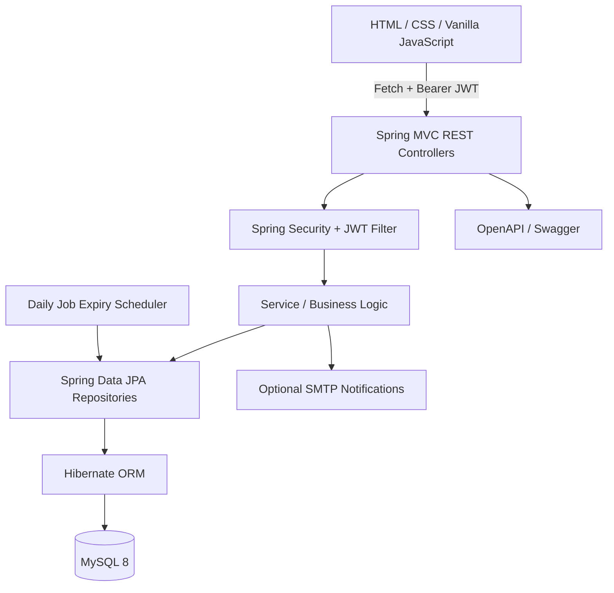
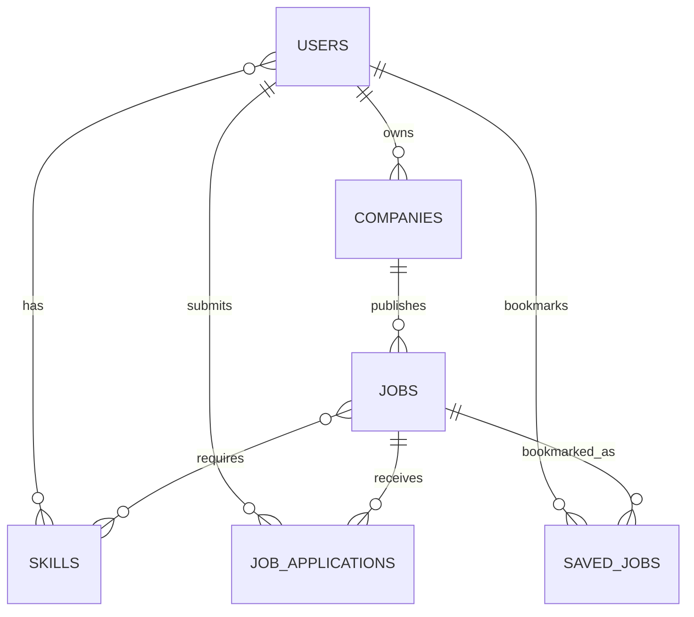

# Architecture overview

## Main entity relationships

## Role model

- `CANDIDATE`: manage own profile, skills, resume, applications and saved jobs.
- `RECRUITER`: manage owned companies and jobs; review applicants for owned jobs.
- `ADMIN`: manage platform accounts, skill catalogue and job moderation; inspect companies and applications.

## Security notes

Passwords are BCrypt encoded. JWTs are stateless bearer tokens. Admin registration is disabled. Candidate resume retrieval is authorized for the candidate, an admin, or a recruiter who has received an application from that candidate. CORS is configured for local development; replace the localhost patterns before deployment.
